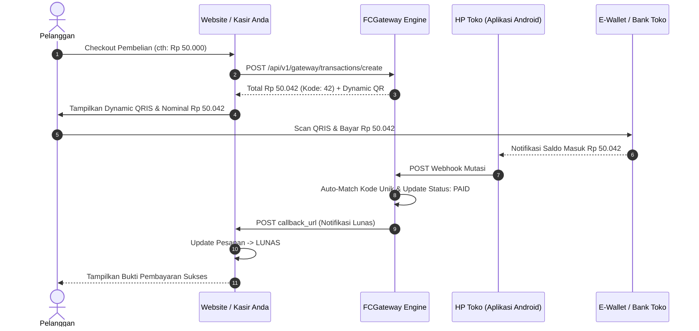

# 📖 Panduan Lengkap Implementasi QRIS Gateway Mandiri (Merchant & Developer Guide)

Dokumentasi teknis ini ditujukan bagi **Merchant, Partner, dan Developer** untuk mengintegrasikan sistem kasir, website e-commerce, bot, atau backend aplikasi Anda langsung ke **QRIS Gateway Mandiri (FCGateway)**.

---

## 1. Konsep & Arsitektur (BYOD - Bring Your Own Device)

Sistem QRIS Gateway ini bekerja dengan prinsip:
1. **0% Biaya Transaksi (Zero Fee / Komisi 0%)**: 100% dana langsung masuk ke rekening bank atau akun e-wallet merchant Anda sendiri (BCA Merchant, Mandiri Livin Usaha, GoPay Merchant, Shopee Partner, Dana Bisnis, Nobu, BRI, dll) tanpa perantara rekening pihak ketiga.
2. **Dynamic QRIS Generation (EMVCo Tag 54)**: Mengonversi QRIS Statis toko Anda menjadi QRIS Dinamis berstandar nasional secara otomatis, sehingga nominal pembayaran terkunci pada aplikasi mobile banking pembeli saat scan.
3. **Pencocokan Otomatis 3-Digit Unique Code**: Setiap tagihan diberikan kode unik acak (Rp 1 - 100) untuk membedakan pembayaran antar-pembeli secara presisi.
4. **Android Listener Device**: HP Android toko yang terinstal aplikasi QRIS Gateway bertindak sebagai pendengar notifikasi mutasi masuk secara realtime via `NotificationListenerService`.



---

## 2. Kredensial & Konfigurasi Merchant

Setiap merchant memiliki kredensial independen (terisolasi multi-tenant):

| Parameter | Sumber / Lokasi | Deskripsi |
|---|---|---|
| **Webhook URL** | Dashboard `/fc/qris-gateway/docs` | URL penerima webhook di server gateway: `https://domain.com/api/v1/gateway/webhook/qris` |
| **Webhook Secret** | Menu Konfigurasi QRIS | Kunci rahasia untuk otentikasi aplikasi HP ke gateway (`X-Gateway-Secret`) |
| **API Key (`X-Api-Key`)** | Dashboard Merchant FCGateway | Kunci akses REST API untuk membuat tagihan transaksi dari server/kasir Anda |
| **String QRIS Statis** | Ekstraksi QR Toko Anda | String mentah EMVCo berawalan `00020101...` dari standee/screenshot QR toko |

---

## 3. Instalasi & Konfigurasi Aplikasi Android

1. **Unduh File APK**:
   - Dapatkan file APK aplikasi QRIS Gateway terbaru dari portal merchant (menu **Unduh APK Android**).
   - Izinkan *"Install Unknown Apps / Sumber Tidak Dikenal"* pada peramban Anda.
2. **Input Kredensial di Aplikasi HP**:
   - Buka aplikasi di HP toko Anda.
   - Isi **Webhook URL** dengan URL webhook gateway toko Anda.
   - Isi **Webhook Secret Key** sesuai dengan secret key di portal.
   - Pilih **Provider** sesuai QRIS toko Anda (GoPay, BCA, Mandiri, Shopee, Dana, Nobu, dll).
3. **Uji Koneksi (Test Ping)**:
   - Tekan tombol **"Test Webhook"** di aplikasi Android.
   - Pastikan muncul notifikasi sukses berwarna hijau:
     `Pong! QRIS Gateway terhubung (<Nama Toko> - <Provider>).`

---

## 4. Pengaturan Sistem Operasi Android yang WAJIB Diaktifkan

Agar Android tidak menghentikan background service aplikasi:

1. **Akses Notifikasi (Notification Access)**:
   - *Pengaturan HP > Privasi / Aplikasi > Akses Khusus > Akses Notifikasi*.
   - Aktifkan izin untuk aplikasi **QRIS Gateway**.
2. **Jangan Batasi Baterai (Unrestricted Battery)**:
   - Tekan lama ikon aplikasi di beranda > *Info Aplikasi (App Info) > Baterai > Pilih "Tidak Dibatasi (Unrestricted)"*.
3. **Autostart / Background Activity**:
   - **Xiaomi / Redmi / Poco**: Aktifkan toggle *"Mulai Otomatis (Autostart)"*.
   - **Oppo / Realme**: Izinkan *"Aktivitas Latar Belakang & Mulai Otomatis"*.
   - **Vivo / iQOO**: Izinkan *"Konsumsi Daya Tinggi di Latar Belakang"*.
   - **Samsung**: Masukkan aplikasi ke *"Aplikasi yang tidak pernah tidur (Never sleeping apps)"*.

---

## 5. Integrasi REST API (Membuat Tagihan)

### Endpoint Buat Transaksi QRIS Dinamis
- **Method**: `POST`
- **URL**: `https://<domain>/api/v1/gateway/transactions/create`
- **Alias Direct**: `https://<domain>/api/gateway/transactions/create` atau `https://<domain>/gateway/transactions/create`

### Request Headers
```http
Content-Type: application/json
Accept: application/json
X-Api-Key: <MERCHANT_API_KEY>
```

### Request Body (JSON)
```json
{
  "amount": 50000,
  "order_id": "INV-2026-00123",
  "customer_name": "Budi Santoso",
  "customer_email": "budi@example.com",
  "customer_phone": "081234567890",
  "callback_url": "https://tokosaya.com/api/payment-callback",
  "return_url": "https://tokosaya.com/checkout/finish?order_id=INV-2026-00123",
  "expire_minutes": 60
}
```

#### Parameter Deskripsi:
| Parameter | Tipe | Wajib? | Keterangan |
|---|---|---|---|
| `amount` | Integer / Float | **Ya** | Nominal dasar tagihan dalam Rupiah (tanpa titik/koma) |
| `order_id` | String | **Ya** | ID referensi pesanan unik dari sistem Anda (max: 100 karakter) |
| `customer_name` | String | Opsional | Nama pembeli |
| `customer_email` | String | Opsional | Email pembeli |
| `customer_phone` | String | Opsional | Nomor telepon pembeli |
| `callback_url` | String (URL) | Opsional | URL endpoint webhook sistem Anda yang akan dipanggil saat lunas |
| `return_url` | String (URL) | Opsional | URL redirect pembeli setelah transaksi selesai |

---

### Response Sukses (HTTP 201 Created)
```json
{
  "status": "success",
  "message": "Tagihan QRIS berhasil dibuat.",
  "data": {
    "id": "01a0ba35-1358-71f1-8354-503473f749d4",
    "order_id": "INV-2026-00123",
    "base_amount": 50000,
    "unique_code": 42,
    "formatted_unique_code": "042",
    "total_amount": 50042,
    "status": "PENDING",
    "checkout_url": "https://domain.com/gateway/pay/01a0ba35-1358-71f1-8354-503473f749d4",
    "qr_image_url": "https://domain.com/gateway/pay/01a0ba35-1358-71f1-8354-503473f749d4/qr.png",
    "dynamic_qris": "00020101021226610014COM.GO-JEK.WWW01189360091431548521670210G1548521670303UMI51440014ID.CO.QRIS.WWW0215ID10254314696550303UMI520489995303360540750042.005802ID5917Fujiwara Creative6007JAKARTA61051541562070703A0163045E6A",
    "expired_at": "2026-09-19T23:45:00.000000Z"
  }
}
```

---

## 6. REST API Cek Status Tagihan & Polling Real-Time

Gunakan endpoint ini untuk memantau status pembayaran transaksi dari frontend/kasir atau backend aplikasi Anda secara berkala (polling):

- **Method**: `GET`
- **URL**: `https://<domain>/api/v1/gateway/transactions/{id}/status`
- **Alias Direct**:
  - `https://<domain>/api/gateway/transactions/{id}/status`
  - `https://<domain>/gateway/transactions/{id}/status`

> **💡 Fleksibilitas Parameter `{id}` (Mencegah Error 404):**
> Anda dapat memasukkan **UUID transaksi FCGateway** (misal `01a0ba35-1358-71f1-8354-503473f749d4`) **ATAU** **`order_id` kustom toko Anda** (misal `INV-2026-00123`). Sistem secara otomatis mendeteksi dan mengembalikan data transaksi yang tepat tanpa error 404.

### Request Headers
```http
Accept: application/json
```

### Response Sukses (HTTP 200 OK)
```json
{
  "status": "success",
  "data": {
    "id": "01a0ba35-1358-71f1-8354-503473f749d4",
    "order_id": "INV-2026-00123",
    "status": "PAID",
    "base_amount": 50000,
    "unique_code": 42,
    "formatted_unique_code": "042",
    "total_amount": 50042,
    "paid_at": "2026-09-19T23:20:15.000000Z",
    "return_url": "https://tokosaya.com/checkout/finish?order_id=INV-2026-00123",
    "expired_at": "2026-09-19T23:45:00.000000Z"
  }
}
```

#### Status Transaksi:
- `PENDING` : Menunggu pembeli melakukan transfer scan QRIS.
- `PAID`    : Pembayaran berhasil diverifikasi otomatis oleh HP toko dan status telah LUNAS.
- `EXPIRED` : Waktu pembayaran habis (default 30 menit) dan slot kode unik dilepaskan.

---

## 7. Integrasi Callback / Webhook ke Backend Anda

### Apakah FCGateway menembak Webhook ke sistem Anda?
**YA.** Saat transaksi berhasil dicocokkan oleh server FCGateway (pembeli mentransfer nominal yang tepat beserta kode unik, atau disetujui via simulasi admin), FCGateway **otomatis menembakkan HTTP `POST`** ke `callback_url` yang Anda kirimkan saat pembuatan transaksi.

> **⚠️ Catatan Penting:**
> Jika saat `create` transaksi parameter `callback_url` dikosongkan (`null`), sistem **tidak akan mengirimkan webhook** ke server Anda. Pastikan selalu mengisi parameter `callback_url` atau gunakan endpoint **Cek Status (Section 6)** untuk polling status.

### Payload Callback (JSON)
```json
{
  "event": "payment.success",
  "transaction_id": "01a0ba35-1358-71f1-8354-503473f749d4",
  "order_id": "INV-2026-00123",
  "base_amount": 50000,
  "unique_code": 42,
  "total_amount": 50042,
  "status": "PAID",
  "paid_at": "2026-09-19T23:20:15.000000Z",
  "provider": "GOPAY",
  "customer_name": "Budi Santoso",
  "customer_email": "budi@example.com"
}
```

### Handler Webhook Contoh (PHP / Laravel)
```php
public function handlePaymentCallback(Request $request)
{
    $payload = $request->all();

    if (($payload['status'] ?? '') === 'PAID') {
        $orderId = $payload['order_id'];
        $paidAmount = $payload['total_amount'];

        // 1. Verifikasi order di database Anda
        $order = Order::where('order_number', $orderId)->first();
        if ($order && $order->status !== 'PAID') {
            $order->update([
                'status'  => 'PAID',
                'paid_at' => now(),
            ]);

            // Kirim notifikasi / proses pengiriman pesanan
        }
    }

    return response()->json(['success' => true]);
}
```

### Handler Webhook Contoh (Node.js / Express)
```javascript
app.post('/api/payment-callback', (req, res) => {
    const { status, order_id, total_amount } = req.body;

    if (status === 'PAID') {
        console.log(`Pesanan ${order_id} lunas sebesar Rp ${total_amount}`);
        // Update database Anda
    }

    res.status(200).json({ success: true });
});
```

---

## 8. Penanganan Kadaluarsa (30 Menit Expiry)

- Setiap tagihan aktif memiliki masa berlaku **30 menit**.
- Jika pembeli tidak membayar dalam 30 menit, status berubah menjadi `EXPIRED` dan slot 3-digit unique code dilepaskan untuk pembeli lain.
- Jika pembeli membayar setelah melewati masa berlaku: dana tetap masuk ke rekening toko merchant 100%, dan notifikasi mutasi tersimpan di riwayat Webhook Log untuk rekonsiliasi manual.

---

## 9. Ringkasan Checklist Sebelum Go-Live

- [ ] String QRIS Statis toko sudah diuji dan preview QR dinamis tampil dengan benar di Dashboard.
- [ ] Aplikasi Android terpasang di HP toko dengan Webhook URL dan Secret Key yang valid.
- [ ] Tombol "Test Webhook" di HP menghasilkan status hijau (Connected).
- [ ] Tiga izin sistem Android (Akses Notifikasi, Unrestricted Battery, Autostart) sudah aktif.
- [ ] Server Anda merespons status `200 OK` pada endpoint `callback_url`.
- [ ] HP toko selalu terhubung ke internet / Wi-Fi toko dan terhubung ke pengisi daya (charger).
